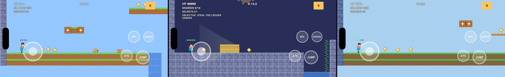

<div align="center">



# 🎮 PLAYER 2 HAS ENTERED THE KINGDOM

### Pixel Kingdom Rumble beta: free on iPhone through TestFlight

<a href="https://testflight.apple.com/join/U6MgRyyP"></a>


**`https://testflight.apple.com/join/U6MgRyyP`**

<br>
<sub>On a computer? Scan this with your iPhone camera.</sub>

</div>

---

## 🕹️ How to join (about 60 seconds)

```
 ┌──────────────────────────────────────────────────────────────┐
 │  STAGE 1-1  Get the free TestFlight app from the App Store   │
 │  STAGE 1-2  Open the link above on your iPhone               │
 │  STAGE 1-3  Tap  ACCEPT  →  INSTALL                          │
 │  STAGE 1-4  Launch Pixel Kingdom Rumble. Go!                 │
 └──────────────────────────────────────────────────────────────┘
```

> [!NOTE]
> **"This beta isn't accepting any new testers"?** Apple reviews each new beta before
> testers can install it. If you see that message, the review is still in progress, so
> try again later. Your link stays the same.

> [!TIP]
> TestFlight builds expire after 90 days. Keep TestFlight's notifications on and you'll
> get every new build automatically.

---

## 🗺️ Your quest log: what to play

| | Mode | Try this |
|:-:|---|---|
| ⚔️ | **Story Quest** | Clear all 3 worlds, beat the two bosses, and explore the four **Shattered Realms** in World 3 |
| 🥊 | **Arena Clash** | Fight the CPU and climb the **Rumble Rating** from Bronze to Legend |
| 📅 | **Daily Rumble** | Play the same twist as everyone else today (low gravity, giants, one stock…) |
| 🎮 | **Versus** | Go 1-on-1 against the CPU with any of the free fighters |
| 👥 | **Couch 2P** | Play with a friend on one phone (split touch) or with controllers |
| 💎 | **Shop › Upgrades** | Spend Star Shards on upgrades and see if they feel worth it |

---

## 📣 Send feedback (this is the real boss fight)

Your feedback shapes the game. You have three ways to send it:

1. **Screenshot it.** Take a screenshot during play and TestFlight will offer to send it with a note. This is the best way to report bugs.
2. **Shake it.** Shake your phone (or open the TestFlight app → Pixel Kingdom Rumble → **Send Beta Feedback**) to write a note.
3. **Crashed?** If the game crashes, TestFlight asks whether to send a crash report. Please tap **Share**.

**The questions we want answered:**

- 🏆 What was the **most fun** moment?
- 😤 What felt **too hard, unfair or confusing**?
- 👆 Did any **touch controls** feel off? Which button, and where?
- 🐛 Did you hit any **bugs or crashes**? What were you doing right before?
- 🔁 Would you **play again tomorrow**? Why or why not?

---

<div align="center">

**HIGH SCORE TABLE**

| RANK | PLAYER | NOTE |
|:-:|:-:|:-:|
| 1ST | YOU | First to send feedback |
| 2ND | YOUR FRIEND | Share the link ↑ |
| 3RD | ??? | Insert coin |

<sub>Pixel Kingdom Rumble is an original game. All characters, art, music and levels are original or placeholder.
<br>Privacy: <a href="PRIVACY.md">PRIVACY.md</a> · Help: <a href="SUPPORT.md">SUPPORT.md</a></sub>

</div>
